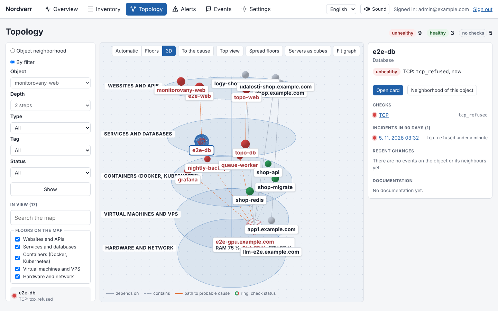
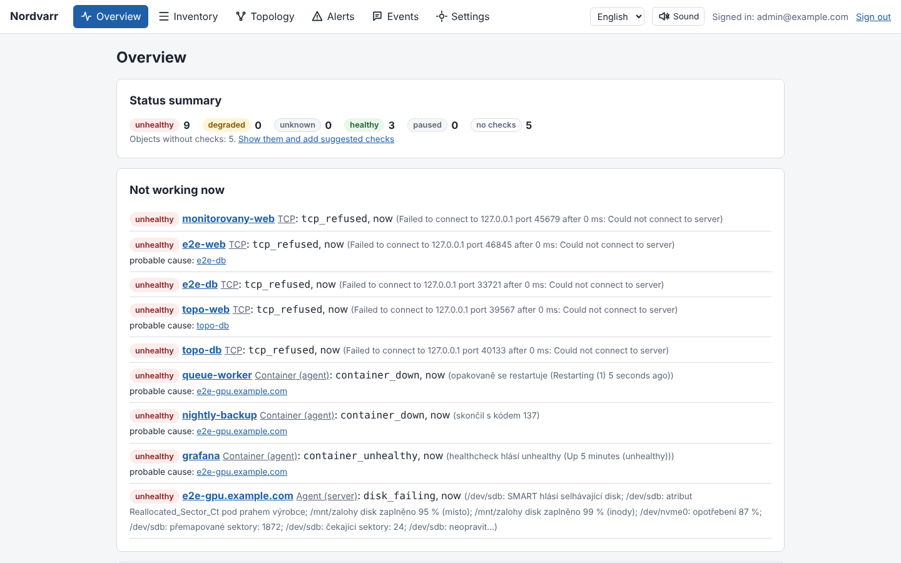
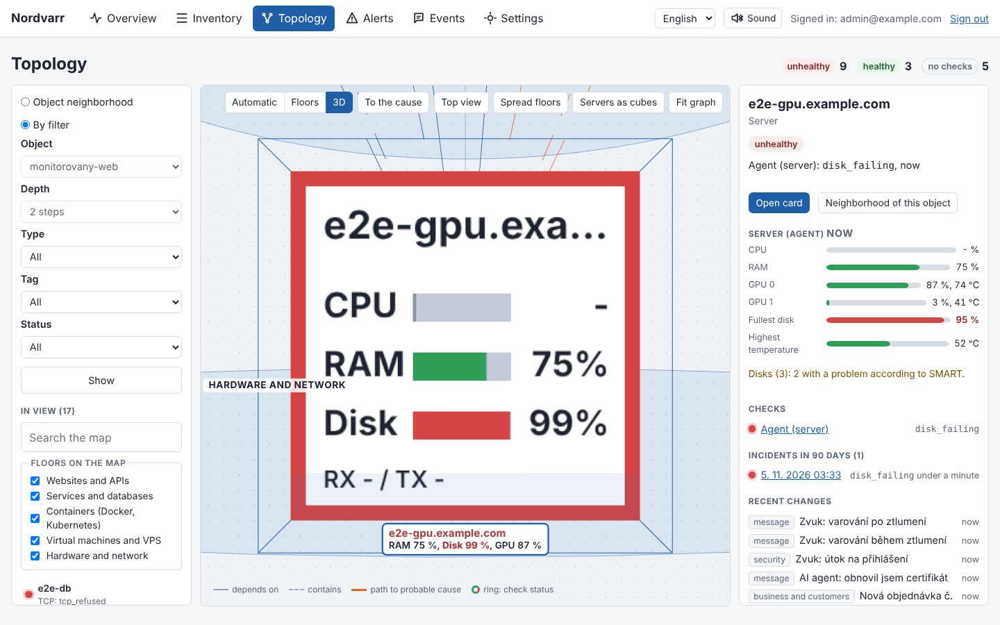
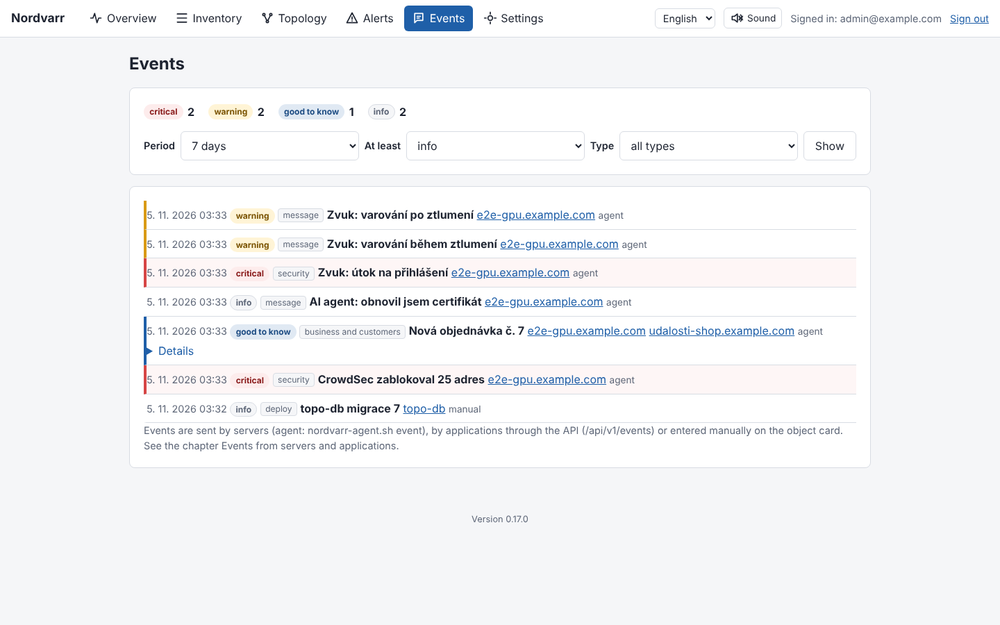
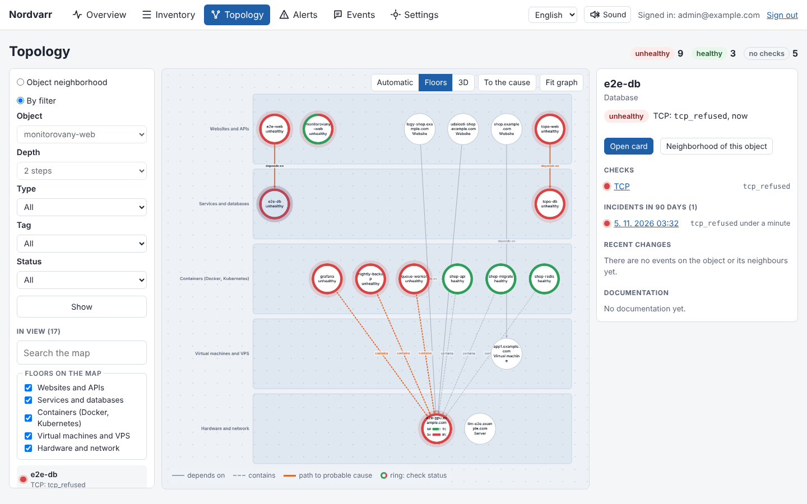
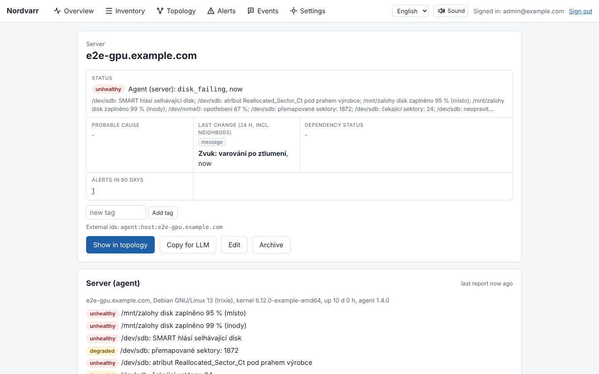

# Nordvarr

**A self-hosted map, monitor and logbook for small infrastructure.**

Nordvarr answers the questions you ask when something breaks at 2 a.m.: *what do we run, what depends on what, is it working, what changed recently, and how is it managed?* It keeps an inventory of your servers, VMs, containers, services, websites and domains, watches them with checks and a lightweight Linux agent, draws the whole thing as a 2D or 3D map, and collects events from your servers and applications into one timeline.

It is a single PHP application with SQLite. No framework, no runtime dependencies, no external services: upload a zip to any PHP host, open `install.php`, add one cron line, done.



## Why Nordvarr

Small teams and solo admins usually have the pieces spread over several tools: an uptime checker, a spreadsheet of servers, notes in a wiki, logs on the servers themselves and alerts in a chat. When something fails, you need all of it at once. Nordvarr puts it in one place and connects it:

- A website check fails, and the map shows that the database it **depends on** is down, so the website alert is marked as a consequence and the database is the **probable cause**.
- The server card shows CPU, RAM, disks, SMART health, systemd services and the last lines of the logs, next to the last deployment and the runbook.
- "Copy for LLM" prepares the whole context of an incident (status, neighbours, recent changes, documentation) with secrets masked, ready to paste into any AI assistant.

## Features

**Inventory and relationships**
- Objects: servers, VMs, clusters, containers, services, databases, websites, domains, network devices, providers (hosting, data centres) and external services (CDN, public DNS, peering).
- Relationships "depends on" and "contains", attributes, tags, documentation in Markdown in categories (operations, runbook, disaster recovery, incidents) with revision history.
- JSON import and export, idempotent API upsert for automation.

**Monitoring**
- Checks: HTTP(S) with status and content, TCP, ping, TLS certificate expiry, domain expiry (RDAP, with a manual date for registries that do not publish it, such as `.eu`), heartbeat (for cron jobs and backups).
- Suggested checks: one click adds sensible checks for a website (HTTP, TLS, domain expiry), a server (ping) or a service.
- Linux agent (one bash script, no daemon): CPU, load, RAM, swap, disks and inodes, temperatures, NVIDIA GPUs, network traffic, SMART health (ATA and NVMe), Docker containers, systemd services, tails of service and website logs.

**Alerts and notifications**
- Alerts with dependency-aware suppression: when a database fails, the websites depending on it do not flood you, they point to the cause.
- Channels: e-mail via SMTP with a fallback SMTP server, Telegram, Discord, generic signed webhook. Every channel has a "Send test" button.
- Maintenance windows (per object or tag) that pause checks and silence alerts.
- Sound notifications in the browser with a different sound for info, warning and critical, a choice of sounds and "mute for 1 hour".

**Topology**
- 2D map of an object's neighbourhood or of a filter, automatic layout or floors (providers, hardware, virtual machines, containers, services, websites, domains, external services).
- 3D view of the floors: drag to rotate, click to select. Servers with the agent can be shown as **cubes with live values on their faces** (CPU and RAM with a 30-minute chart, disks, network); clicking a face turns it towards you.
- Coloured resource bars on server nodes (green, orange, red by the agent thresholds), "show path to cause" mode.

**Events**
- One timeline of everything that happened: deployments, maintenance, security events (fail2ban, CrowdSec), business events (new order, support form), messages (for example from an AI agent working on the server).
- Four severities with colours: info, notice, warning, critical. Events come from the agent, from applications through the API or are entered by hand.

| Overview | Server as a cube | Events |
|---|---|---|
|  |  |  |

| Topology in floors (2D) | Server card with agent data |
|---|---|
|  |  |

The user interface is available in **Czech and English** (switch in the top bar).

## Requirements

- PHP 8.4 or newer with `pdo_sqlite`, `curl`, `openssl`, `mbstring`
- Apache with `mod_rewrite` (recommended) or any server that can route to `public/index.php`; works without rewriting too (`index.php?r=` URLs)
- Cron (or a systemd timer) running the worker every minute
- For the agent on monitored servers: Linux, bash 4.4+, curl, coreutils; optionally `smartmontools`, `nvidia-smi`, Docker

## Installation

1. Download `nordvarr-<version>.zip` from the [releases](https://github.com/MrRolid/Nordvarr/releases) and unpack it. You get a `nordvarr/` directory.
2. Upload it to the server, for example to `/var/www/nordvarr`.
3. Point the web server's document root to `/var/www/nordvarr/public`. Nothing outside `public/` may be reachable from the web.
4. Open `https://nordvarr.example.com/install.php` and fill in the data directory (database, logs, backups; outside the web root), the administrator account and the time zone.
5. Add the cron line shown at the end of the installation:

   ```
   * * * * * php /var/www/nordvarr/bin/nordvarr.php worker >/dev/null 2>&1
   ```

The installer locks itself once `config.php` exists. Example Apache virtual host:

```apache
<VirtualHost *:443>
    ServerName nordvarr.example.com
    DocumentRoot /var/www/nordvarr/public
    <Directory /var/www/nordvarr/public>
        AllowOverride All
        Require all granted
    </Directory>
    SSLEngine on
    SSLCertificateFile /etc/ssl/certs/nordvarr.example.com.pem
    SSLCertificateKeyFile /etc/ssl/private/nordvarr.example.com.key
</VirtualHost>
```

### Updating

Unpack the new release over the application directory (your `config.php` and data directory are never overwritten). Database migrations run automatically on the next administrator login, or run them yourself; a database backup is made before each migration:

```
sudo -u apache php /var/www/nordvarr/bin/nordvarr.php migrate
```

## First steps

1. **Settings -> Notification channels**: add an e-mail (SMTP with an optional fallback server), Telegram or Discord channel and press "Send test".
2. **Inventory**: create your servers and websites (or import JSON), connect them with "depends on" and "contains".
3. On each object card, accept the **suggested checks**, or select many objects in the inventory and add suggested checks in bulk.
4. Install the **agent** on your Linux servers (below).
5. Open **Topology**: it starts in 3D with all objects. Switch on "Servers as cubes".

## The agent

The agent is a single bash script that reports once a minute over HTTPS. It is driven by a systemd timer (or cron), needs no daemon and sends nothing but what is described here.

### Install

Create an API token with the scope `agent:write` in **Settings -> API tokens** (one token is enough for all servers), then on the server as root:

```
NV=https://nordvarr.example.com
curl -fsSL $NV/agent/nordvarr-agent.sh -o /usr/local/bin/nordvarr-agent.sh
chmod 755 /usr/local/bin/nordvarr-agent.sh
curl -fsSL $NV/agent/nordvarr-agent.service -o /etc/systemd/system/nordvarr-agent.service
curl -fsSL $NV/agent/nordvarr-agent.timer -o /etc/systemd/system/nordvarr-agent.timer

install -m 600 /dev/null /etc/nordvarr-agent.conf
cat > /etc/nordvarr-agent.conf <<'EOF'
NORDVARR_URL=https://nordvarr.example.com
NORDVARR_TOKEN=nv_...
EOF

/usr/local/bin/nordvarr-agent.sh --test
systemctl daemon-reload && systemctl enable --now nordvarr-agent.timer
```

The first report creates the server object (or attaches to an existing one with `NORDVARR_OBJECT_ID=<object id>`) and an "Agent" check with thresholds you can change on the server card.

### What it reports

CPU, load, RAM and swap, disk and inode usage, temperatures, NVIDIA GPU usage, network throughput, SMART health every 15 minutes, Docker containers (each becomes an object with its own check), systemd services (a failed or stopped enabled service is a problem) and every 10 minutes the last 50 lines of service logs. Secrets in logs are masked on arrival.

### Website logs

Enter paths to log files on a website card (part **Logs**), one per line. The agent on the server the website runs on picks them up automatically. When several websites share one log file, add a filter after a vertical bar and the agent sends only the matching lines:

```
/var/log/httpd/weby_access_log | shop.example.com
```

For security, the agent reads only files under the directories in `NORDVARR_LOG_ALLOW` (default `/var/log /var/www`), resolved through symlinks.

### Events and websites from the server

```
# A message, for example from an AI agent working on the server
nordvarr-agent.sh event "AI agent: renewed the certificate for shop.example.com"

# A security event with severity and details
nordvarr-agent.sh event -s warning -t security "fail2ban banned 203.0.113.7" "jail sshd, 12 attempts"

# A business event attached to a website
nordvarr-agent.sh event -s notice -t business -w shop.example.com "New order #1042"

# Register a new website on this server, with its log and suggested checks
nordvarr-agent.sh site shop.example.com /var/www/shop/access.log --checks
```

fail2ban, as an action in `/etc/fail2ban/action.d/nordvarr.conf`:

```
[Definition]
actionban = /usr/local/bin/nordvarr-agent.sh event -s warning -t security -i "f2b-<name>-<ip>-<time>" "fail2ban (<name>) banned <ip>" "failures: <failures>"
actionunban =
```

## API

All machine endpoints use a bearer token with a scope (`inventory:write`, `events:write`, `agent:write`, `context:read`).

```
# Create or update an object (idempotent by source and external_id)
curl -sS -X POST "$NV/api/v1/objects/upsert" -H "Authorization: Bearer $TOKEN" -H "Content-Type: application/json" \
  -d '{"external_id":"web:shop.example.com","type":"website","name":"shop.example.com",
       "relationships":[{"kind":"depends_on","to_external_id":"vm:app1"}]}'

# Record an event, for example from your deployment pipeline or your shop
curl -sS -X POST "$NV/api/v1/events" -H "Authorization: Bearer $TOKEN" -H "Content-Type: application/json" \
  -d '{"event_id":"deploy-42","type":"deploy","severity":"info","occurred_at":"2026-11-05T10:00:00Z",
       "summary":"release 42","objects":[{"external_id":"web:shop.example.com"}]}'

# Heartbeat from a cron job or backup script
curl -fsS "$NV/hb/<token>"

# Incident context for an LLM (masked)
curl -sS "$NV/api/v1/objects/<id>/context?format=markdown" -H "Authorization: Bearer $TOKEN"
```

## Security

- Passwords hashed with Argon2id or bcrypt, CSRF protection, strict Content Security Policy (no inline scripts), rate-limited login.
- API tokens are stored only as HMAC hashes; channel secrets (SMTP passwords, Telegram and Discord tokens) are encrypted with the application secret.
- Secrets in exports, LLM context and logs are masked.
- The agent token is passed to curl through a file, never on the command line; remote log paths are restricted to allowed directories.

## Development

```
scripts/setup-cloud.sh    # prepare the environment (PHP 8.4, Composer, Node, Playwright)
composer test             # PHPUnit
npm run e2e               # Playwright: builds the release zip, installs it and walks through the UI
php -S 127.0.0.1:8080 -t public bin/dev-router.php   # local server
bin/build-release.sh      # dist/nordvarr-<version>.zip
```

The detailed administrator guide is in [`docs/NAVOD.md`](docs/NAVOD.md), the development log in [`docs/STAV.md`](docs/STAV.md), the decision log in [`docs/ROZHODNUTI.md`](docs/ROZHODNUTI.md) and the original specification (in Czech) in [`SPEC.md`](SPEC.md).
